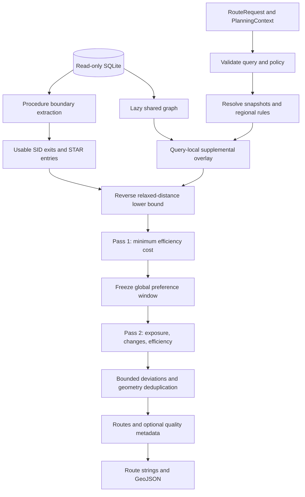
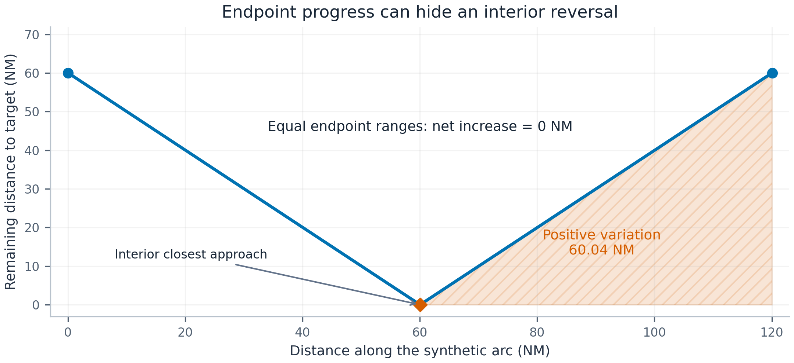
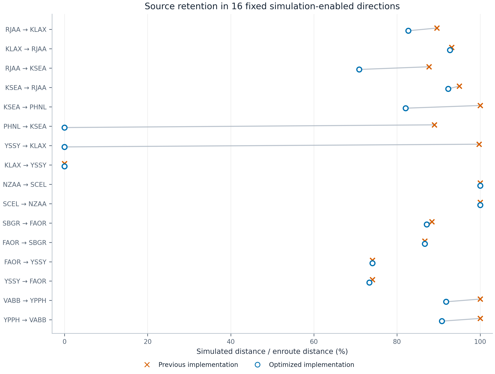
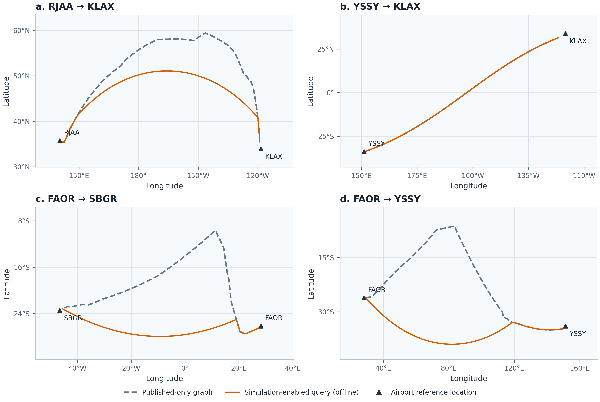

# Airway RouteKit: Algorithm and Implementation Reference

**Implementation snapshot:** November 7, 2026. **Scope:** procedure-aware enroute planning and route-string interpretation. **Units:** nautical miles (NM), feet, Unix seconds, and degrees unless otherwise stated.

[README](../README.md) · [Implementation map](#12-implementation-and-resource-model) · [Validation](#13-validation-methodology) · [Results](#14-evaluation-and-observed-results) · [References](#17-references)

> **Snapshot and reproduction note:** This reference preserves the advanced implementation's November 7, 2026 algorithm descriptions, validation methodology, measurements, and figures in full. Validation counts and timings are historical snapshot results, not newly measured claims. This repository intentionally omits standalone integration tests, research datasets, and figure-generation tools; the corresponding commands and artifact names in Sections 13 and 15 describe the original workflow. All current C ABI functions are declared in [routekit.h](../routekit.h).

## Abstract

RouteFinder Advanced searches a directed navigation graph between enroute-facing departure and arrival procedure boundaries. It addresses excessive direct connections, incorrect terminal interfaces, geographically inappropriate gateway selection, and implausible route geometry. The implementation preserves the original RouteKit public models and C ABI while adding optional context and quality results.

The method combines verified procedure-boundary extraction, a history-dependent nonnegative efficiency objective, an analytical distance-regression term, and a constrained lexicographic preference pass. Search labels retain altitude and distance resources rather than keeping a single best scalar cost at each node. Oceanic connections are directed atomic paths with explicit provenance; optional regional catalogs constrain gateway roles, geometry, capability declarations, and validity. A separate dynamic-programming parser interprets route strings against the same graph.

Validation combines exhaustive tiny-graph search oracles, synthetic SQLite fixtures, real-navigation-data regressions, independent raw-row checks, and geometry-preserving preview tests. A recorded 64-scenario oceanic matrix demonstrates source-retention improvements, while showing that graph coverage and operational rule availability remain limiting factors. This is an engineering implementation, not a certified flight-planning system or a claim that classical search methods are new.

## 1. Problem definition and design boundaries

### 1.1 What is optimized

Let $`a`$ and $`b`$ be the departure and destination airports. The planner chooses a SID exit $`s`$, a STAR entry $`t`$, and an enroute path $`P`$ from $`s`$ to $`t`$. It does not choose a complete SID/STAR pair, model runway-dependent trajectories, propagate aircraft performance through procedure legs, or assign a vertical profile.

Airport-to-gateway great-circle distances contribute to endpoint selection and quality budgets. These are **terminal distance proxies**, not reconstructed procedure lengths. They are not inserted as returned segments. Generated `Route` objects contain enroute segments only; `sid` and `star` remain `None`.

The feasible search space contains published database edges and explicitly supplied supplemental connections. There is no implicit complete graph, nearest-coast connector, nearest-airway DCT, or general free-route authorization rule. A no-route result can reflect incomplete data or a restrictive query; it does not prove that no real-world route exists.

### 1.2 Defects and mechanisms

| Basic-planner defect | Implemented mechanism | Qualification |
| --- | --- | --- |
| DCT chains replace nearly equivalent airways | Bounded source preference and terrestrial-direct entry cost | A material efficiency gain can still justify an explicit direct connection |
| Internal procedure fix becomes an endpoint | Enroute-facing boundary extraction and graph identity checks | A VOR remains valid if it really is the boundary |
| Poorly oriented departure/arrival gateway | Joint gateway search with directional endpoint and join costs | Geography is a soft cost, not a north/south ban |
| Local backtracking and zigzags | Whole-arc regression, turns, repeated-point rejection | Available-network detours can remain |
| World-wrapping preview | Great-circle densification and antimeridian splitting | Viewer projection and overlaid alternatives also matter |
| Individually valid edges have incompatible heights | A common altitude interval in each label | This is not climb/descent planning |

### 1.3 Interpretation of guarantees

Optimality is relative to the implemented objective, graph, supplied context, altitude envelope, and resource limits. The best route is searched across all usable endpoint candidates. Additional routes come from bounded deviations, not an exact K-shortest-path algorithm.

Costs are engineering preferences, not published separation minima or universal aviation rules. Regional provenance is caller-asserted: the engine verifies consistency with a declaration, not authenticity of a publication.

## 2. Architecture and data provenance



SQLite is opened read-only. The airway graph is loaded lazily and shared through `Arc`. Gateways and waypoint resolutions have separate caches. The spatial index supplies lookup APIs; proximity does not authorize routing edges. A supplemental overlay shares the large graph payload and adds a small suffix.

The development fixture is a compatible SQLite navigation database, AIRAC 2611. Field interpretations below describe this adapter, not every ARINC 424 record type or every supplier's schema. Section 12 maps the theory to individual source modules.

## 3. Navigation graph construction

### 3.1 Identities and sections

Define a directed multigraph $`G=(V,E)`$. A vertex is a resolved navigation identity, not merely a name. A database reference ID is the primary key when available; otherwise the loader combines region, identifier, facility type, and coordinates rounded to seven decimal places.

Reusing a reference with a different identifier, region, or coordinate displacement exceeding 0.05 NM is rejected. Same-name fixes in different regions remain distinct. Procedure matching checks region, coordinate proximity, and compatible qualified references.

Airway rows are sorted by `route_identifier` and `seqno`. A new section starts when the airway changes or the preceding row carries the adapter's end marker. Only adjacent rows within a section form edges. Duplicate sequence numbers on one airway are errors. Sharing an airway name cannot bridge disconnected sections.

### 3.2 Direction, category, altitude, and courses

The fixed-wing adapter accepts route types `O`, `R`, `C`, `D`, and `S`, and level codes `H`, `L`, and `B`. Restriction `F` creates the forward edge, `B` the reverse edge, and an empty restriction both. Unknown direction restrictions are errors. Unsupported route/level rows receive no guessed interpretation.

For edge $`e`$, bounds in feet are $`[L_e,U_e]`$. Forward traversal uses `minimum_altitude1`; reverse traversal uses `minimum_altitude2`, falling back to `minimum_altitude1`. Both use the row's maximum altitude. Unknown bounds are represented by 0 and 100,000 ft. A contradictory interval $`L_e>U_e`$ excludes that directed edge with a warning; an unrelated invalid edge does not invalidate the graph.

Published magnetic courses must be finite and in the accepted input range. Reverse traversal uses the destination row's inbound course plus 180°, normalized modulo 360°. Search excludes edges without a usable published course. Supplemental geometry uses caller-supplied constant magnetic variation. These checks do not reconstruct an unknown altitude or magnetic model.

### 3.3 Geometric length

With latitude/longitude $`(\phi_i,\lambda_i)`$ in radians and $`R=3440.065`$ NM,

```math
q=\sin^2\frac{\phi_2-\phi_1}{2}+\cos\phi_1\cos\phi_2\sin^2\frac{\lambda_2-\lambda_1}{2},
\qquad
d=2R\mathrm{atan2}(\sqrt{q},\sqrt{1-q}).
```

The implementation clamps $`q`$ to $`[0,1]`$. All search and returned distances use the same spherical geometry rather than mixing computed lengths with published row distances. Published distances remain record metadata. Great-circle length is an engineering approximation, not an ellipsoidal survey solution or fuel/time prediction.

## 4. Enroute-facing procedure boundaries

### 4.1 Branch roles

Procedure rows are grouped by procedure identifier, route type, and transition, then ordered by sequence. The adapter's exact role mapping is:

| Procedure | Role 0 | Role 1 | Role 2 |
| --- | --- | --- | --- |
| SID | `1, 4, F` | `2, 5, M` | `3, 6, S` |
| STAR | `1, 4, 7, F` | `2, 5, 8, M` | `3, 6, 9, S` |

Numeric families `1/2/3`, `4/5/6`, and `7/8/9` remain separate; other accepted types form another family. Unknown or engine-out branch types are not guessed into ordinary gateway roles.

The candidate is the **last** leg of a SID branch and the **first** leg of a STAR branch. It must have a named, coordinate-resolved fix and a fixed-position termination among `IF`, `TF`, `CF`, `DF`, `RF`, and `AF`. A manual/unresolved boundary does not cause substitution of an earlier named fix.

### 4.2 Suppressing internal interfaces

A boundary is suppressed if a compatible branch in the same family extends farther toward enroute: higher role for a SID, lower role for a STAR. This prevents runway/common interfaces from becoming gateways when an outward section exists. The rule is conservative even when branch interfaces do not match cleanly.

Named enroute transitions do not impose runway identity. If both transition IDs begin with `RW`, they must match, with the adapter's shared-runway `B` convention also accepted. This does not choose an active runway or establish current procedure applicability.

Candidates are sorted and deduplicated by resolved identity. The query retains departure candidates with usable outgoing edges and arrival candidates with usable incoming edges. An empty side yields an explicit missing-connection error instead of a proximity DCT.

### 4.3 Direction-sensitive selection

All usable candidates participate in a single search; no first-three or nearest-three truncation determines the best result. Let $`\beta(x,y)`$ be initial great-circle bearing, $`\Delta`$ the smaller bearing difference in radians, and

```math
A(\alpha,\gamma)=\frac{1-\cos\Delta(\alpha,\gamma)}{2},
\qquad S=\mathrm{clamp}(0.1d(a,b),20,80).
```

For distance weight $`w_d`$, the endpoint costs are

```math
C_a(s)=w_d d(a,s)+S A(\beta(a,s),\beta(a,b)),
```

```math
C_b(t)=w_d d(b,t)+S A(\beta(b,t),\beta(b,a)).
```

The angular term is zero below 0.1 NM airport/gateway separation. The arrival expression looks from the destination back toward the origin, preferring the incoming side. These smooth costs permit a less favorably oriented gateway when its network connectivity compensates.

Departure and arrival joins add $`10A(\cdot,\cdot)`$. The departure compares the arriving bearing at $`s`$ from $`a`$ with the first edge's initial bearing; the arrival compares the last edge's final bearing with $`\beta(t,b)`$. Each join is zero within 0.1 NM of its airport.

## 5. Whole-arc distance regression

### 5.1 Why endpoint progress is insufficient

Let $`r(x)=d(x,b)`$ be remaining destination distance. An endpoint-only penalty $`\max(0,r(v)-r(u))`$ misses an arc that approaches the destination and then recedes to its original range. Evaluating only stored reporting points also makes a penalty depend on subdivision.

Instead, define the positive variation along a physical curve $`\gamma`$, parameterized by traveled distance $`s`$:

```math
B(\gamma)=\int_\gamma\max\left(0,\frac{dr}{ds}\right)\,ds.
```

For a piecewise great-circle path, sum this quantity across arcs. It measures accumulated increases in remaining distance, including increases after an interior closest approach. It is not net displacement and does not categorically forbid necessary backtracking.

### 5.2 Analytical evaluation

Parameterize a minor arc of length $`\ell`$ by angular distance $`\theta\in[0,\alpha]`$, where $`\alpha=\ell/R`$. In a basis of the great-circle plane, the dot product with the destination unit vector is

```math
z(\theta)=A_0\cos\theta+B_0\sin\theta,
\qquad r(\theta)=R\arccos z(\theta).
```

The endpoint ranges determine

```math
A_0=\cos\frac{r(0)}{R},
\qquad
B_0=\frac{\cos(r(\alpha)/R)-A_0\cos\alpha}{\sin\alpha}.
```

Interior stationary points satisfy

```math
\theta_k=\mathrm{atan2}(B_0,A_0)+k\pi.
```

Evaluate stationary points strictly inside the arc together with both endpoints. For their ordered remaining ranges $`r_0,\ldots,r_m`$,

```math
B(e)=\sum_{i=0}^{m-1}\max(0,r_{i+1}-r_i).
```

The numerical implementation uses $`R\mathrm{atan2}(\sqrt{1-z^2},z)`$ with clamped $`z`$. Tiny or singular arcs fall back to nonnegative endpoint range increase. A normal minor arc has at most one interior stationary point. Antipodal geometry is intrinsically ambiguous; simulator and export paths reject their ambiguous long-leg cases.

### 5.3 Additivity

For a split at $`c`$ on the same physical arc,

```math
B(a\rightarrow b)=B(a\rightarrow c)+B(c\rightarrow b).
```

Adding collinear reporting points therefore does not remove or multiply the penalty. Supplemental paths sum their actual polyline arcs. Rounding simulated points to whole minutes can introduce small real geometry changes; those rounded polylines are not claimed to be exactly identical to the original great circle.



*Figure 1. Synthetic equatorial example, not a flight route. An arc from 1°W to 1°E passes through a target at 0°. Endpoint range increase is zero, but the second half accumulates approximately 60.04 NM of regression. Shading identifies the contributing half; regression is its range increase, not the shaded area under the range curve.*

## 6. Primary efficiency objective

### 6.1 Complete cost

For $`P=(e_1,\ldots,e_m)`$ from $`s`$ to $`t`$, the implemented objective is

```math
\begin{aligned}
J_0(P)={}&C_a(s)+C_b(t)+J_a(e_1)+J_b(e_m)\\
&+\sum_{i=1}^{m}\left[w_d(\ell_i+\lambda B(e_i))+D_i+U_i+I_i\right]\\
&+\sum_{i=2}^{m}T(e_{i-1},e_i).
\end{aligned}
```

Here $`\lambda`$ is `regression_weight`; $`D_i`$ is the terrestrial direct contribution; $`U_i`$ penalizes unknown minimum altitude; $`I_i`$ sums internal turns in an atomic path; and $`J_a,J_b`$ are the endpoint joins. Every term is nonnegative under validated configuration.

The default $`\lambda=2`$ adds two distance-cost units per NM of regression. There is no primary airway-switch fee: a route's labeling should not dominate a comparison between nearly identical geometries. Changes between adjacent preferred connections are handled by the preference pass.

### 6.2 Geometric turn cost

For angle $`\delta`$ in degrees between consecutive final and initial bearings,

```math
T=10\left(\frac{\max(0,\delta-30)}{150}\right)^2.
```

Turns up to 30° cost zero; a 180° join costs 10. Atomic supplemental paths sum this expression at internal vertices. Arriving bearings are used, avoiding confusion between an arc's initial and final bearings at high latitude.

This term is geometric smoothness, not bank-angle, turn-radius, fly-by anticipation, or protected-airspace computation. Subdividing an unchanged great-circle arc adds no true internal turn; altering a polyline can.

### 6.3 Terrestrial direct cost

An eligible direct edge has

```math
D=\frac{w_a}{0.8}\left(\eta\ell+\kappa\,\mathbf{1}_{\mathrm{entry}}\right),
```

where $`w_a`$ is `airway_preference_weight` and the mode constants are:

| Preference | $`\eta`$ | $`\kappa`$ | Preference pass |
| --- | ---: | ---: | --- |
| `AirwayPreferred` | 1.00 | 30 | Enabled |
| `Balanced` | 0.35 | 12 | Enabled |
| `DirectPreferred` | 0.00 | 0 | Skipped |

The entry fee applies to a new terrestrial direct run. In the implemented continuation predicate, a preceding direct edge whose role is not oceanic counts as continuation. There is no fixed charge for every reporting-point-to-reporting-point DCT, so subdivision alone does not multiply the fee.

Oceanic-role supplemental edges and connections classified as `PublishedTransition` are exempt from this terrestrial penalty. They still face source exposure, geometry, altitude, validity, and efficiency constraints. A simulated land transition is not automatically a published transition.

### 6.4 Unknown minimum altitude

An edge with no known minimum altitude contributes

```math
U=0.005w_h\ell,
```

where $`w_h`$ is `altitude_match_weight`. With default $`w_h=0.5`$, the increment is $`0.0025\ell`$. This discourages missing information without manufacturing a restriction; the interval checks remain separate.

### 6.5 Defaults and units

| Parameter | Default | Purpose |
| --- | ---: | --- |
| `distance_weight` | 1.0 | Distance and regression scaling |
| `airway_preference_weight` | 0.8 | Terrestrial direct scaling |
| `altitude_match_weight` | 0.5 | Unknown-minimum scaling |
| `regression_weight` | 2.0 | Positive destination-range variation |
| `equivalent_ratio` | 0.002 | Preference-window fraction |
| `equivalent_min_nm` | 3.0 | Window floor |
| `equivalent_max_nm` | 20.0 | Window ceiling |
| `detour_warning_ratio` | 1.15 | Diagnostic threshold |

Join and turn terms are fixed cost units. Scaling $`w_d`$ alone changes their relative strength; $`J_0`$ is not simply a rescaled path length. Weights and policies must be finite and nonnegative, and $`w_d`$ must be positive.

## 7. Bounded lexicographic source preference

### 7.1 One frozen efficiency reference

For feasible set $`\mathcal{F}`$, first solve

```math
J_0^*=\min_{P\in\mathcal{F}}J_0(P).
```

Let $`D^*`$ be that reference route's enroute length plus terminal proxies. With default policy,

```math
\varepsilon=w_d\mathrm{clamp}(0.002D^*,3,20),
\qquad C_{\mathrm{pref}}=J_0^*+\varepsilon.
```

The window is in **efficiency-cost units**. It does not promise at most $`\varepsilon`$ additional physical NM: endpoint angles, turns, altitude uncertainty, and direct terms also affect $`J_0`$. Its fraction and bounds are configurable.

Both the reference and window are frozen before preference search and reused for alternatives. Re-centering around each preferred alternative would allow cumulative drift. Increasing `max_routes` does not intentionally widen the best-route window.

### 7.2 Exposure and changes

Preferred classes are `PublishedAirway`, `PublishedTrack`, and `PublishedTransition`. Define

```math
X(P)=\sum_{e\in P}\ell_e\,\mathbf{1}\left[\mathrm{class}(e)\notin\mathcal{C}_{\mathrm{preferred}}\right].
```

`PublishedDirect`, `PermittedRandom`, and `Simulation` contribute physical distance. Nonpreferred is an objective classification, not a statement that a permitted-random connection is unauthorized.

Let $`M(P)`$ count adjacent pairs whose classes are both preferred and whose airway/path identifiers differ. The implementation does not remember an older airway across an intervening nonpreferred edge. It uses the incoming edge as its history state.

The second pass solves

```math
\min_{\substack{P\in\mathcal{F}\\J_0(P)\le C_{\mathrm{pref}}}}
\bigl(X(P),M(P),J_0(P)\bigr)
\quad\text{lexicographically}.
```

Actual nonpreferred distance is minimized before changes or small efficiency differences. This works when every feasible route requires some nonpreferred distance; it does not depend on an all-airway path existing.

### 7.3 Consequences

A negligible shortcut loses to an equivalent published path inside the window. A material shortcut can win if the published path is outside it. `DirectPreferred` skips the preference stage, while retaining graph, altitude, regression, and other feasibility constraints.

In the recorded YSSY→KLAX case, the geometric shortcut saves about 0.012 NM but also changes turn representation. The retained published route is approximately 7.05 cost units above the efficiency reference, within an approximately 13.04-unit window. The explanation is a bounded **cost** comparison rather than a geometric-distance-only threshold.

## 8. Resource-constrained search

### 8.1 Labels and altitude continuity

A label stores node $`v`$, incoming edge $`p`$, parent index, efficiency accumulation $`g_0`$, objective accumulation $`g`$, preferred-change count $`M`$, physical distance $`D`$, distance/lifetime limit $`\bar D`$, altitude interval $`H`$, and step count $`n`$.

Incoming edge history matters for turn, direct-entry, and change costs. Labels are bucketed by $`(v,p)`$; a single scalar best-at-node value would discard relevant history.

For `Custom(FL)`, initialize $`H_0=[100FL,100FL]`$, with $`FL\in[1,1000]`$. Otherwise initialize $`[0,100000]`$. Traversing $`e`$ updates

```math
H'=H\cap[L_e,U_e].
```

An empty intersection rejects the extension. Individually traversable edges can therefore form an infeasible path. `High` admits categories `H/B`; `Low` admits `L/B`. Neither sets a cruise altitude. `None` and `Custom` do not impose that category filter.

### 8.2 Physical-distance resource

Define total proxy distance

```math
D_{\mathrm{proxy}}(P)=d(a,s)+\sum_{e\in P}\ell_e+d(t,b).
```

The default hard bound is

```math
\bar D_{\mathrm{query}}=1.5d(a,b)+200\ \mathrm{NM}.
```

`SearchOptions.detour_budget` can override it or disable it with `None`. This broad bound limits poor graph fallbacks, but is a product-quality constraint, not an airspace rule. It is separate from the 1.15 diagnostic ratio.

A partial label's $`D`$ includes the departure proxy and edges already traveled. Because $`r(v)=d(v,b)`$ lower-bounds remaining length, prune when $`D+r(v)>\bar D`$. Recheck a complete route with its actual edges and both proxies.

### 8.3 Reverse admissible lower bound

Reverse Dijkstra [1] runs over currently allowed edges. Arrival gateways are seeded with $`C_b(t)`$ and reversed edges have weights $`w_d\ell_e`$:

```math
h(v)=\min_{v\leadsto t}\left[w_d\sum\ell_e+C_b(t)\right].
```

All other nonnegative costs and path-wide altitude/history constraints are relaxed. Every feasible completion costs at least $`h(v)`$. An unrealistic altitude combination in the relaxed graph only makes the bound more optimistic. Unreachable departure gateways are removed.

The first-pass queue uses $`g_0+h(v)`$, applying the admissible-search principle of A* [2]. The second-pass key is $`(g_X,g_M,g_0+h(v))`$, using zero lower bounds for future exposure and changes. Reject a preference label when $`g_0+h(v)>C_{\mathrm{pref}}`$. A completed goal adds arrival endpoint and join costs; continue until no queued key can improve the best completed key.

### 8.4 Sufficient dominance

Within the same $`(v,p)`$ bucket, implemented dominance requires

```math
\begin{aligned}
g_A&\le g_B,&g_{0,A}&\le g_{0,B},&M_A&\le M_B,\\
D_A&\le D_B,&\bar D_A&\ge\bar D_B,&H_A&\supseteq H_B,\\
n_A&\le n_B.
\end{aligned}
```

Here $`g`$ is efficiency accumulation in pass 1 and exposure in pass 2. Lower exposure does not compensate for insufficient remaining efficiency budget. A cheaper label also cannot erase another label with useful additional altitude range, later lifetime, shorter distance, or fewer steps.

This is a multi-criterion label approach [3] with implementation-specific resources and ordering. Componentwise dominance is deliberately sufficient rather than maximally aggressive: extra labels are preferable to incorrectly pruning useful states.

### 8.5 Elementary fallback and physical geometry

Fast search forbids an immediate endpoint return. A reconstructed candidate is checked for repeated physical coordinates, quantized to seven decimal places with normalized longitude. Supplemental geometry is expanded for this check: a hidden intermediate oceanic reporting point cannot conceal a repeated physical location.

If a candidate repeats a point, search is repeated with elementary-path checks. Each extension's new physical points must be absent from its ancestry. Dominance then also requires visited-set inclusion, preventing a label that has consumed more points from discarding a less constrained label.

This is a repeated **stored-point** check, not a continuous-curve self-intersection algorithm. Distinct arcs can cross away from their reporting points. Such crossings are not universally forbidden, and the implementation does not claim to calculate maneuver feasibility.

### 8.6 Budgets and conditional optimality

Defaults are 5,000 ms search timeout, 2,000 graph-edge depth, and an internal limit of 500,000 labels per A* invocation. Periodic deadline checks share one query search deadline across required passes and alternative attempts. Database/context preparation precedes establishment of this deadline, so it is not a wall-clock bound on the whole API call.

Timeout and arena exhaustion are explicit budget errors, not ordinary route-not-found results. A required unfinished preference pass does not silently return an optimality claim. Depth is part of the bounded feasible problem; depth exhaustion without a result is reported explicitly. Optional alternative attempts can stop while retaining the established best result.

For the available finite graph and implemented resource/depth limits, nonnegative increments, admissible bounds, and sufficient nondominated labels support minimum-efficiency search and the subsequent constrained lexicographic search. The exhaustive tests check these claims on tiny graphs without reusing heap ordering or dominance. They do not establish database completeness or operational validity.

### 8.7 Search outline

```text
validate request, options, policy, and optional regional catalog
resolve directed supplemental paths; build a query-local overlay
extract all verified SID exits and STAR entries with usable connections
compute reverse relaxed-distance lower bounds
reference = solve(EFFICIENCY, all gateways, physical/altitude resources)
if no reference: return explicit infeasibility or budget error
limit = reference.cost + tolerance(reference.proxy_distance)
if preference != DirectPreferred:
    best = solve(EXPOSURE, CHANGES, EFFICIENCY; base_cost <= limit)
else:
    best = reference
collect bounded deviations, preserving the original reference and limit
rank, deduplicate physical geometry, and build compatible results
append optional quality and source diagnostics
```

## 9. Alternatives, quality, and result semantics

### 9.1 Bounded deviations

For `max_routes > 1`, generate deviations by excluding the best departure gateway, excluding its arrival gateway, or banning selected physical edge geometries. Candidate edge positions include the start, approximate thirds, midpoint, end, and airway-change positions; at most ten edge positions are attempted, in addition to the endpoint deviations. Equivalent parallel edges for a banned geometry are excluded together.

Each attempt first finds its efficiency solution, then uses the original preference window when feasible. Alternatives outside that window remain eligible but rank after those inside it. Inside-window ordering is $`(X,M,J_0)`$; outside-window ordering is efficiency cost. `DirectPreferred` orders by efficiency throughout.

Signatures expand supplemental geometry and normalize physical coordinates. A label-only change does not create a distinct alternative. The best route is independent of an intentional gateway shortlist and is solved before alternative generation. The pool can be smaller than requested, and it is not Yen's algorithm or an exact K-shortest enumeration.

### 9.2 Quality diagnostics

The additive `PlanningResult` carries legacy `RouteSearchResult` plus `quality` aligned with its routes and `skipped_connections`. Quality includes efficiency/reference costs, the fixed limit, regression, proxy detour ratio, source distances, participating region IDs, and flags. Define

```math
Q(P)=\frac{D_{\mathrm{proxy}}(P)}{d(a,b)}.
```

| Flag | Current trigger | Meaning |
| --- | --- | --- |
| `detour_requires_review` | $`Q>1.15`$, configurable | Review network coverage and applicable restrictions |
| `local_regression` | $`B(P)>1`$ NM | Physical enroute geometry contains measurable range regression |
| `outside_preference_window` | $`J_0>C_{\mathrm{pref}}`$ | An alternative exceeds the best route's fixed preference limit |
| `offline_simulation` | Any simulation source used | Supplemental geometry has no operational-authorization claim |

A warning is not automatically a rejection. Necessary graph detours survive the warning threshold if they satisfy the hard budget. Conversely, missing verified gateways, bad context, or an exhausted required search are errors rather than routes with a warning.

### 9.3 Compatible serialization

Legacy detailed results retain `Route`, `RouteSegment`, and related field layouts. Simplified results retain `route_string` and `total_distance_nm`. Optional richer metadata belongs to separate context/result APIs, not extra required fields in old request types.

A macro path expands into endpoint/coordinate `RouteSegment` values with `airway: None`, preserving the old structure and parser roundtrip. That legacy field alone cannot distinguish a published track from a simulation. Consumers requiring provenance must use diagnostics or `quality.sources`, not infer authorization from the presence of DCT text.

Estimated time is enroute distance divided by configured constant cruise speed, multiplied by 60. It is not wind-corrected and excludes terminal proxies and procedure trajectories.

## 10. Oceanic and regional context

### 10.1 Directed atomic paths

An `OceanicPath` declares an identifier, source, role (`Oceanic` or `Transition`), exact database endpoints, intermediate whole-minute coordinates, flight-level bounds, and constant magnetic variation. It is one directed graph edge with a stored physical polyline.

Intermediate coordinates are not junctions. Search cannot enter halfway, leave halfway, reverse an undeclared path, or switch between two tracks at an incidental crossing. Connections can join at explicit shared endpoints. Internal geometry participates in distance, regression, turns, repeated-point checks, and output expansion.

Endpoint resolution checks identifier, region, coordinate agreement below $`10^{-6}`$ NM, and compatible reference IDs. Whole-minute coordinates are losslessly representable in output tokens; higher precision is rejected rather than silently discarded. Degenerate and repeated reporting points are rejected during preparation.

### 10.2 Source classes and simulation

| Class | Origin | Preferred in pass 2? |
| --- | --- | --- |
| `PublishedAirway` | Ordinary database airway edge | Yes |
| `PublishedDirect` | Database direct-type edge | No |
| `PublishedTrack` | Caller-supplied snapshot, oceanic role | Yes |
| `PermittedRandom` | Regional snapshot with explicit rule declaration | No |
| `PublishedTransition` | Snapshot transition, including a compatible regional declaration | Yes |
| `Simulation` | Explicit offline geometry | No |

`OceanicSource::Simulation` requires `allow_simulation=true`. The helper constructs a great-circle baseline using caller-selected endpoints, with spacing from 10 to 600 NM, rounded whole-minute intermediate points, and default FL290–FL410 bounds. This helper does not discover operational gateways or turn a baseline into a published route.

`OceanicSource::Snapshot` requires nonempty provenance, a valid half-open interval, and an explicit planning time. In legacy options without a regional catalog, snapshot oceanic/transition roles map to published-track/transition classes. These are caller assertions; authenticity is not inferred from JSON.

### 10.3 Conservative journey validity

Every used snapshot, and every used regional rule interval, must remain valid for the **whole estimated proxy journey**, rather than only at departure or at the edge's estimated entry time. For end time $`T_u`$, planning time $`T_0`$, and speed $`V`$ in knots, the implementation constrains

```math
D_{\mathrm{proxy}}\le\frac{V}{3600}(T_u-T_0-1).
```

The one-second margin conservatively preserves the exclusive upper validity boundary. A label retains the minimum limit from all used sources and the query budget. This is intentionally stronger than checking a track only when traversed; it can reject a route that a more detailed time-propagating system would accept.

Planning time is caller supplied; the engine does not silently use the machine clock. Cruise speed must be finite and within 50–1,000 knots. No winds, holding, climb, or time-varying speed model is integrated.

### 10.4 Regional declaration and roles

A region declares `identifier`, `version`, `rules_reference`, validity, convex spherical boundary, excluded areas, database-verified gateways, and connections. Each gateway declares `Entry`, `Exit`, and/or `Land` roles. Duplicate physical gateway declarations are rejected; combine roles on one gateway instead.

Oceanic paths must be Entry→Exit. Transition paths must be Land→Entry or Exit→Land. `PublishedTrack`, `PermittedRandom`, and `PublishedTransition` regional kinds require compatible snapshot sources and roles. A simulation cannot be promoted by changing only its regional kind.

Connections may require explicit capability strings. Missing capabilities or inactive snapshots/rules skip the connection and create `SkippedConnection` diagnostics, leaving other routes available. Invalid declarations are errors. The planner does not infer aircraft equipment, evaluate RNP performance, or authenticate the supplied rule publication.

The catalog can connect declared database gateways even when no useful baseline graph path exists. It does not derive its candidate endpoints from whichever baseline route happened to be returned. No real operational catalog is shipped; the test catalogs are clearly synthetic.

### 10.5 Spherical boundaries and exclusions

For latitude $`\phi`$ and longitude $`\lambda`$, embed coordinates as

```math
x=(\cos\phi\cos\lambda,\cos\phi\sin\lambda,\sin\phi).
```

A region is a convex minor-great-circle polygon fitting in one open hemisphere. For adjacent vertices $`v_i,v_{i+1}`$, orient the normalized normal $`n_i\propto v_i\times v_{i+1}`$ toward the polygon center. Membership requires

```math
n_i\cdot x\ge-\tau\quad\text{for all }i,
```

with numerical tolerance. Degenerate, ambiguous-hemisphere, and nonconvex inputs are rejected. For a convex region, membership of each polyline vertex implies membership of its minor arcs. Nonconvex operational areas must be split into supported convex components offline.

Exclusions are checked against whole arcs, not just vertices. Potential crossings are the two normalized intersections of great-circle planes; a crossing must lie on both minor arcs. Collinear overlap and endpoint containment are also checked. This supports antimeridian-crossing regions without ambiguous longitude boxes. Oceanic-role geometry must remain within its boundary; transition geometry can extend to a declared land gateway but is still checked against exclusions.

Catalog caps are 32 regions, 64 total supplemental connections including legacy options, 128 gateways per region, 32 exclusion polygons per region, and 3–128 vertices per polygon after optional closure removal. A path has at most 126 intermediate points. These bounds keep validation and overlay construction finite; they do not approximate arbitrary global airspace topology.

## 11. Contextual parsing and display geometry

### 11.1 Token normalization and candidate identities

The parser uppercases input, normalizes supported punctuation, splits route tokens, and removes a small set of filler words. Departure/destination airports are recognized when present. Runway tokens are retained only as warnings/context; they do not prove procedure applicability.

Each token can provide several waypoint identities, an oceanic coordinate, an airway operator, or a recognized departure/arrival procedure annotation. Exact `SID`, `STAR`, and `DCT` tokens have special meaning; substrings inside legitimate waypoint identifiers do not. Database-known procedures are context annotations, not expanded trajectories.

### 11.2 Dynamic-programming recurrence

A state at token position $`i`$ contains last resolved fix $`v`$ (or no current fix), cumulative geometric score $`g`$, error count $`e`$, and reconstruction parent. Candidates at the same position and physical identity are ranked by $`(e,g)`$. For a transition consuming $`k`$ tokens,

```math
F(i+k,v')=\min_{\mathrm{lex}}\left[F(i+k,v'),\;F(i,v)+(\Delta e,\Delta g)\right].
```

Transitions are:

1. **Waypoint:** choose a candidate identity, add great-circle distance from the preceding fix (or departure), and emit a waypoint/direct element.
2. **Explicit DCT plus endpoint:** consume both tokens and add their geometric distance. Explicit DCT does not authorize the connection operationally.
3. **Named airway plus endpoint:** expand only a continuous directed section linking the current and target fixes; add its physical length.
4. **Procedure annotation:** retain the last fix and add context without trajectory expansion.
5. **Unresolved token:** increment errors, emit `Unknown`, and clear the last fix, preventing a synthetic bridge across the gap.

Unqualified hops are limited to 3,000 NM, with 1,000 NM for the first fix from a known departure. These sanity filters do not apply to explicit DCT transitions. A final airport-distance score helps resolve otherwise ambiguous terminal identities. The parser minimizes errors before distance and uses deterministic state order for ties.

Future airway context can thus disambiguate a same-name fix. It is not merely a greedy nearest-fix parser. `Network::expand` requires endpoints, a common airway section, and permitted edge direction; it never returns an arbitrary suffix when an endpoint is missing.

Input is capped at 512 tokens and an ambiguity guard rejects more than 100,000 accumulated states. The parser does not have a flight-level request, so syntactic/directional expansion is not equivalent to the searcher's fixed-altitude feasibility check. It also cannot recover snapshot validity, provenance, or capability declarations from a bare DCT string.

### 11.3 Parse validity and roundtrip

`ParsedRoute.is_valid` requires an empty error list and recognized departure and destination airports. It does not itself require a nonempty enroute element list or repeat the search feasibility checks. Flexible mode retains partial interpretation; it does not erase unknown-token errors. DCT and procedure annotations produce warnings about the limits of their validation.

The formatter compresses consecutive segments on one airway only when their physical endpoints are continuous. Supplemental points are emitted as explicit DCT coordinate tokens. Regression tests expand the parsed result and compare every identifier/coordinate against the generated physical route, not just the final route string. This checks lossless interpretation for the tested cases, not universal ambiguity elimination in all future datasets.

### 11.4 Great-circle preview export

For each segment, `route_geojson()` samples the minor great circle using a requested maximum display spacing from 1 to 600 NM. Densification changes neither the searched graph nor the route's distance. Disconnected geometry, ambiguous antipodal legs, and more than 100,000 display points are rejected.

When consecutive dense points cross ±180°, a 48-step bisection locates the great-circle crossing. End one part at +180° or −180° and start the next at the opposite signed longitude. Output is one `Feature` containing `LineString` or `MultiLineString`. Coordinate order is longitude, latitude. This follows the antimeridian-cutting convention in GeoJSON [4].

A preview is enroute only. It does not draw an invented airport-to-gateway procedure. Inspect a single alternative when assessing shape: a collection of three valid routes overlaid in one color can look like a single route doubling back. Map projection can also distort long arcs; a globe-rendering artifact is not evidence that the physical path reverses.

## 12. Implementation and resource model

### 12.1 Source map

| Responsibility | Implementation |
| --- | --- |
| Read-only pooling, lazy graph, lookup and gateway caches | [database.rs](../src/database.rs) |
| Physical identity, directed sections, altitude/course records, airway expansion | [network.rs](../src/network.rs) |
| Procedure branch roles and enroute boundaries | [gateways.rs](../src/gateways.rs) |
| Multi-label search, resources, two passes, alternatives, quality assembly | [route.rs](../src/route.rs) |
| Great-circle geometry and analytical regression | [geo.rs](../src/geo.rs) |
| Optional policy, source classes, quality types | [planning.rs](../src/planning.rs) |
| Atomic path preparation, simulation, shared overlays | [oceanic.rs](../src/oceanic.rs) |
| Regional roles, provenance consistency, spherical polygons | [regions.rs](../src/regions.rs) |
| Contextual interpretation | [parser.rs](../src/parser.rs) |
| Display-only GeoJSON | [geojson.rs](../src/geojson.rs) |
| Spherical R-tree lookups | [spatial.rs](../src/spatial.rs) |
| Ownership and JSON C ABI | [ffi.rs](../src/ffi.rs), [routekit.h](../routekit.h) |

### 12.2 Shared storage and caches

`SharedVec` stores immutable graph nodes, edges, records, and airway names behind shared vectors, with a query-local suffix. Overlay construction shares those large payloads. Adjacency vectors and lookup maps are still cloned; overlays are not zero-copy and cost is not independent of the graph size.

The graph and coordinate range arrays support direct indexing. Destination ranges are computed once per query. A lazy per-edge regression cache avoids repeatedly evaluating spherical extrema across labels and passes. Supplemental paths compute their actual internal geometry.

The result cache defaults to 1,000 entries. Its key serializes the normalized request and planning context; graph identity guards against reuse after a graph reload. Queries with supplied oceanic paths or any regional catalog bypass result caching, avoiding stale time-sensitive overlays. Calling `reload_spatial_index()` also invalidates graph, gateway, waypoint, and route caches; the name understates that broader invalidation.

### 12.3 Spatial lookup

The R-tree stores three-dimensional unit vectors instead of raw longitude/latitude. For angular radius $`\theta=d/R`$, chord radius is

```math
c=2\sin(\theta/2).
```

Chord distance preserves nearest-neighbor ordering on the sphere and avoids antimeridian and high-latitude failures of a flat coordinate radius. Radius results are finally filtered using great-circle distance. This index is for lookup; the legacy `spatial_search_radius_nm` setting does not inject search edges.

### 12.4 Complexity and lightweight design

Reverse Dijkstra has usual adjacency-list complexity $`O((|V|+|E|)\log|V|)`$. A multi-resource search has no general single-label $`O(|E|\log|V|)`$ bound: nondominated label counts can grow substantially. If $`N_L`$ labels survive, queue work is roughly $`O(N_L\log N_L)`$ plus edge extensions and bucket dominance comparisons; elementary fallback additionally scans ancestry.

The practical controls are shared graph payload, a reusable relaxed bound, bounded context sizes, lazy geometry costs, a finite label arena, and a query deadline. The method does not add a graph-service dependency, global fine-mesh ocean grid, meteorological solver, or aircraft-performance optimizer. Those would solve different problems and increase resource requirements.

### 12.5 Public API and ABI boundary

The original `RouteRequest`, `Route`, `RouteSegment`, simplified results, and `routekit.h` are preserved. The additive APIs are `find_routes_with_options`, `find_routes_with_context`, and their C equivalents. See the [README](../README.md#c-and-go-usage) for complete ownership-safe C++ usage and JSON shapes.

Rust consumers receive typed errors. C callers receive null on call errors and a borrowed thread-local error message. Owned result strings use Rust allocation and must be returned through `routekit_free_string`. A parsed JSON response with `is_valid=false` is a successful API call describing invalid input, not a null-pointer failure. Foreign pointers must be valid and the handle must outlive every call.

## 13. Validation methodology

### 13.1 Layered evidence

Validation separates algorithm correctness, database interpretation, serialization compatibility, and observed route quality. No one layer substitutes for the others. A smooth preview cannot prove airway legality; an existing SQL row cannot prove full path altitude compatibility; a valid parse cannot authenticate a track source.

| Layer | Evidence | What it checks |
| --- | --- | --- |
| Search oracle | Exhaustive simple paths on tiny generated graphs | Optimal objective and resource handling without heuristic/dominance reuse |
| Synthetic integration | Temporary SQLite fixtures | Gateway selection, sections, direction, altitude, parser, context validation |
| Geometry | High-latitude/dateline and subdivision tests | Physical distance, regression additivity, display splitting |
| Public compatibility | Rust serialization and C smoke programs | Existing shapes, ownership, new additive wrappers |
| Real navdata | Explicitly enabled integration tests | Named regressions, raw rows, endpoints, parse roundtrip |
| Regional experiment | 64 fixed scenario queries | Observed outcomes on one database and explicit experimental contexts |

### 13.2 Independent search oracle

The tiny-graph test uses 48 generated seven-node directed graphs, three route preferences, varied altitude bands, and finite physical-distance budgets. It enumerates physical-node-simple paths without the search heap, reverse heuristic, or label dominance and compares the best efficiency score against A* with the reverse bound and with a zero heuristic.

For preference search, it independently enumerates complete candidate paths, fixes an efficiency cap, and compares $`(X,M,J_0)`$ across tolerances 0, 0.5, 3, and 20 and several distance budgets, again with and without the heuristic. Enumeration reuses the implemented edge-cost definitions; it independently validates **search**, not a second derivation of all cost formulas. Separate geometry tests cover the analytical formula.

### 13.3 Targeted regressions

The tests cover internal procedure points, manual terminations, conventional/RNAV branch separation, valid VOR boundaries, all-gateway search, one-way sections, reverse-direction minima, incompatible path altitude ranges, useful expensive labels, and storage-order determinism. Parser regressions include ambiguous names, unknown-token continuity breaks, false suffix expansion, and identifiers containing reserved substrings.

Planning tests verify fixed-window source retention, meaningful efficiency gains, minimum exposure when no all-published path exists, regional connectivity without baseline sampling, bad roles/provenance, source promotion rejection, exact database identity, capability/validity skips, full-arc exclusions, antimeridian polygons, zero-area polygons, duplicate gateway aliases, hidden macro-point loops, and a longer forward published route preferred over a shorter backtracking one.

### 13.4 Commands and recorded counts

```sh
cargo fmt --all -- --check
cargo clippy --locked --all-targets -- -D warnings
cargo test --locked
ROUTEKIT_TEST_DB=/path/to/e_navdata.s3db \
  cargo test --locked --test real_navdata -- --ignored --nocapture
cargo build --locked --release
```

The snapshot recorded **69 ordinary tests, 5 real-data tests, and 6 Rust documentation tests**, all passing. Ordinary runs intentionally skip real-data tests. The legacy and advanced C smoke programs also passed against the release dynamic library. README Rust snippets and the C++ example are compiled separately when refreshing this documentation.

The local data tests use fixed development-cycle identifiers and fail on a missing file rather than silently succeeding. They are regression fixtures, not a universal certification suite for arbitrary navdata providers or cycles.

## 14. Evaluation and observed results

### 14.1 Dataset and experimental design

The recorded November 7, 2026 run used the local `e_navdata.s3db` navigation database, AIRAC 2611.

Eight pairs were tested bidirectionally: RJAA–KLAX, RJAA–KSEA, KSEA–PHNL, YSSY–KLAX, NZAA–SCEL, SBGR–FAOR, FAOR–YSSY, and VABB–YPPH. These cover seven labeled oceanic test regions. Each direction has four modes: default High category, default FL350, explicit simulation High, and explicit simulation FL350: **16 directions × 4 modes = 64 scenarios**.

Simulation endpoints were experimental database fixes selected from earlier graph routes using geographic test envelopes, not an operational gateway catalog. The same saved candidates were reused before and after optimization. This controls candidate-set changes but leaves selection biased toward baseline coverage. Separate regional-catalog tests use fixed declared gateways without sampling the returned baseline route.

Several interacting costs and preference rules changed between implementations. This is a before/after engineering regression study, not a randomized experiment or full causal ablation. There is one timed query per scenario, not repeated independent performance samples.

The original study references `ocean-regression-metrics.csv` and `evaluation.json`, with selected geometry in `preview-routes.geojson`. These research artifacts are absent from the available advanced snapshot and are not bundled here; the original result tables and exported figures are preserved below. The referenced files contain neither the navigation database nor a verified operational catalog.

### 14.2 Scenario results

Distances below are **enroute NM**, excluding terminal proxies. Published-only means no supplemental candidates were supplied. Simulation-enabled means candidates were available, not necessarily selected. This table uses High-category runs; FL350 results remain in the CSV.

| Direction | Optimized published-only | Previous simulation-enabled | Optimized simulation-enabled |
| --- | ---: | ---: | ---: |
| RJAA → KLAX | 4,990.2 | 4,724.3 | 4,732.6 |
| KLAX → RJAA | 4,973.8 | 4,725.7 | 4,731.2 |
| RJAA → KSEA | 4,166.6 | 4,008.1 | 4,013.4 |
| KSEA → RJAA | 4,190.4 | 4,056.2 | 4,061.4 |
| KSEA → PHNL | 2,087.2 | 2,063.4 | 2,066.9 |
| PHNL → KSEA | 2,093.6 | 2,092.4 | 2,093.6 |
| YSSY → KLAX | 6,281.2 | 6,281.2 | 6,281.2 |
| KLAX → YSSY | 6,304.2 | 6,304.2 | 6,304.2 |
| NZAA → SCEL | 6,290.4 | 5,077.7 | 5,077.7 |
| SCEL → NZAA | 6,290.4 | 5,077.7 | 5,077.7 |
| SBGR → FAOR | 4,707.7 | 3,962.7 | 3,969.1 |
| FAOR → SBGR | 4,939.3 | 4,037.3 | 4,037.3 |
| FAOR → YSSY | 7,538.6 | 6,141.0 | 6,141.0 |
| YSSY → FAOR | 7,562.2 | 6,149.3 | 6,152.4 |
| VABB → YPPH | 3,789.2 | 3,685.6 | 3,752.8 |
| YPPH → VABB | 3,656.3 | 3,620.1 | 3,627.6 |

High-category success does not establish FL350 feasibility. For example, the published-only YSSY→FAOR High-category geometry has a common envelope reaching only 24,500 ft; an FL350 query can use other airway records along the geometry with a compatible interval.

Distances do not all decrease. The second pass accepts bounded efficiency differences to reduce nonpreferred exposure. Gateway proxies, angles, and direct penalties also mean the reference efficiency path need not minimize enroute distance alone.

### 14.3 Near-equivalent source retention

YSSY→KLAX previously chose 1 published segment plus 16 simulated DCT segments for approximately 6,281.211 NM, versus 6,281.223 NM published-only. The optimized result retains all 25 published segments and uses no simulation, at a geometric difference of approximately 0.012 NM:

```text
YSSY NOBAR A579 NN B581 FICKY KLAX
```

PHNL→KSEA also stops using a marginal simulated shortcut. A materially useful candidate remains available: RJAA→KLAX is approximately 4,990.2 NM on the optimized published graph and 4,732.6 NM with explicit simulation candidates. This is bounded source-aware optimization, not an absolute DCT ban.



*Figure 2. Each row is one fixed High-category, simulation-enabled direction, with one observation per implementation. The x-axis is simulated distance divided by enroute distance. Markers show previous and optimized outcomes; connectors pair the same scenario rather than imply a trend across directions. There are no confidence intervals or significance claims. All non-airway segments in this particular experiment were checked against explicit simulation inputs; this equivalence must not be assumed for arbitrary callers.*

Across 64 scenarios, summed simulated distance changed from approximately 119,525.2 NM to 99,012.0 NM, a 17.2% reduction in this matrix. The sum includes both directions and altitude modes; it is neither a fleet metric nor an independent-sample estimate. Segment counts changed from 314 to 260, but the objective minimizes distance rather than coordinate subdivision count.

### 14.4 Shape, coverage, and unresolved detours

All 64 results passed generated-to-parsed point comparison, terminal-gateway matching, distance consistency, and no repeated stored physical points. Preview checks verified no antimeridian jump within a part and preservation of summed distance. Independent raw SQL checks verified **1,358 published segment instances** for direction/category/altitude and **260 simulation segment instances** against their contexts. These are uses across scenarios, not unique edges.

The optimized matrix contains 26 simulation-flagged, 12 detour-review, and 2 regression-flagged results. The latter are published-only FAOR→SBGR in High and FL350 modes, accumulating approximately **29.12 NM** of whole-arc regression. The earlier endpoint-only reporting metric was approximately 27.29 NM; these different metrics must not be presented as deterioration caused by optimization.

Increasing regression weight from 2 to 10 and 100 returned the same FAOR→SBGR geometry in the sensitivity runs. This shows that weight tuning alone did not help those runs, not that all networks force backtracking. Supplied experimental oceanic geometry yields approximately 4,037.3 NM with no measured regression, but remains an offline simulation without operational-authorization evidence.



*Figure 3. One best route per condition, not several alternatives overlaid. Dashed gray is optimized published-only; orange is optimized with explicit simulation candidates. Axes use locally continuous longitudes across the Pacific. Geometry is enroute only, with no invented SID/STAR connectors. Coincident YSSY→KLAX curves illustrate near-identical geometry despite a source-selection difference. These previews are not aeronautical charts.*

### 14.5 Timing and reproducibility limits

With release optimization and result caching disabled, the first recorded query took approximately **185.4 ms**, including lazy graph loading. RouteKit construction and spatial-index initialization were outside the timer. Subsequent 63 queries had median **12.4 ms** and maximum **79.6 ms**. Timing covers the planning call, excluding later parser/preview verification and separate alternative-stability queries.

These are one local macOS run's observations, without randomized ordering, repeated-run variance, or a hardware-normalized throughput claim. The record does not retain sufficient hardware/toolchain metadata to recreate identical timing. Reproduce behavior using the tests and the same navigation-data cycle; use new repeated benchmarks for performance claims.

### 14.6 Focused mechanism tests

Synthetic fixtures isolate mechanisms separately from the regional study. Zero preference tolerance returns strict efficiency; a positive window retains a comparable published path. When nonpreferred travel is unavoidable, the solver minimizes its extent. A large shortcut survives preference.

Another fixture offers a shorter backtracking published route and a longer forward one. Zero regression weight selects the former; weight 2 selects the latter with zero measured regression. This demonstrates the cost mechanism under controlled connectivity, not that every real-data defect can be solved by tuning weights.

## 15. Practical integration and reproducibility

### 15.1 Interface selection

Use `find_routes` or `find_routes_simple` for existing integrations. Use `find_routes_with_options` for explicit paths and its established diagnostics wrapper. Use `find_routes_with_context` for regional validation, policy, source classes, flags, and skipped-connection explanations.

The C ABI exposes all analogous functions in the single `routekit.h` header. Custom FL JSON uses an externally tagged object such as `{"Custom":350}`, rather than a string such as FL350. Rust `Default` is not a blanket JSON default; supply the required request fields.

### 15.2 Reproduce local behavior

Use versioned source and lockfile, obtain a compatible licensed database, run synthetic checks, and explicitly enable real-data tests. `examples/navdata_check.rs` prints routes and local timings. `examples/oceanic_check.rs` builds experimental North Atlantic candidates and exports results; it is not an operational registry.

The archived 64-query matrix used a temporary research harness, not an installed benchmark command. The original workflow recorded compact measurements and selected geometry, but those source artifacts, its full candidate catalog, and its runner are not bundled in this snapshot. The CSV alone cannot re-run every original query. Full reproduction needs those exact contexts, the database, and both source snapshots.

### 15.3 Rebuild figures

The original `tools/render_documentation_figures.py` workflow reads the CSV and preview GeoJSON and generates PNG/SVG assets with Python, NumPy, Matplotlib, and Pillow. It neither executes routing nor downloads navdata. That script and its input datasets are absent from the available advanced snapshot; the exported PNG/SVG assets are included here unchanged. The command below records the original invocation and requires restoring those artifacts first.

```sh
python tools/render_documentation_figures.py
```

The data figure displays individual paired observations, the regression illustration uses explicitly synthetic geometry, and previews use geographic graticules without a third-party chart background. Documentation rendering introduces no Rust runtime dependency.

## 16. Limitations and future work

The model has no wind field, aircraft-performance/fuel model, step climbs, ETOPS/EDTO evaluation, dynamic weather avoidance, NOTAM ingestion, complete FIR policy engine, or live NAT/PACOTS retrieval. An airway graph does not fully describe random-route permissions, free-route airspace, or oceanic clearances.

Regional declarations constrain supplied candidate geometry; they do not search continuous free-route space or construct detours around exclusions. Callers prepare convex components and candidates. Capabilities are declarations rather than certified equipment checks. Lifetime validation uses conservative whole-journey constant-speed proxies, not detailed entry/exit times.

Gateway extraction follows branch structure without selecting a runway or proving current transition availability. A VOR can be a legitimate boundary. A convenient nearby fix cannot become a gateway without supporting procedure data.

Multi-resource search can retain many labels. Guarantees are conditional on the implemented graph, costs, bounded resources, and completed search. Alternatives have limited completeness. Continuous-arc crossings, restricted-area completeness, and maneuver-level flyability need additional models.

Useful next work includes verified versioned regional datasets, richer time propagation where justified, broader provider/cycle fixtures, and repeated controlled benchmarks. Such extensions should preserve provenance and use optional context rather than alter legacy schemas or treat simulation as permission.

## 17. References

1. E. W. Dijkstra. **A Note on Two Problems in Connexion with Graphs.** *Numerische Mathematik* 1, 269–271, 1959. [DOI: 10.1007/BF01386390](https://doi.org/10.1007/BF01386390). Background for nonnegative shortest paths and reverse relaxed search.
2. P. E. Hart, N. J. Nilsson, and B. Raphael. **A Formal Basis for the Heuristic Determination of Minimum Cost Paths.** *IEEE Transactions on Systems Science and Cybernetics* 4(2), 100–107, 1968. [DOI: 10.1109/TSSC.1968.300136](https://doi.org/10.1109/TSSC.1968.300136). Background for admissible heuristic search; this implementation adds resources and history.
3. E. Q. V. Martins. **On a Multicriteria Shortest Path Problem.** *Discrete Applied Mathematics* 7(3), 253–258, 1984. [DOI: 10.1016/0166-218X(84)90045-1](https://doi.org/10.1016/0166-218X(84)90045-1). Background for nondominated labels; the exact objectives and resources here are implementation-specific.
4. H. Butler et al. **The GeoJSON Format.** RFC 7946, 2016, Section 3.1.9, antimeridian cutting. [RFC Editor](https://www.rfc-editor.org/rfc/rfc7946.html#section-3.1.9). The exporter densifies its spherical curves before representing them as GeoJSON line segments.

Formulas, constants, adapter mappings, and conditional guarantees here derive from the linked implementation. These foundational publications do not certify RouteFinder's aviation applicability.
